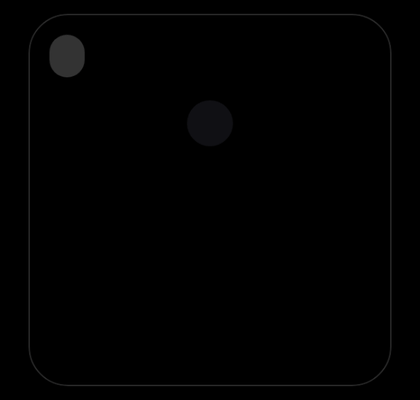
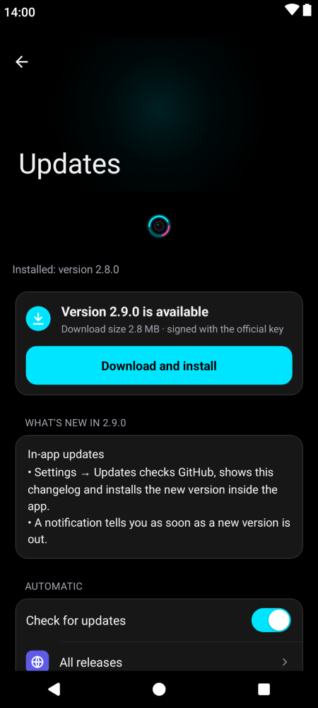
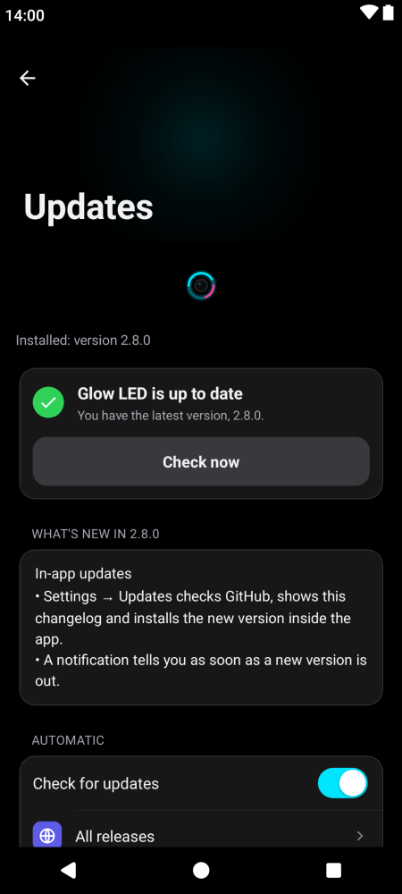

<div align="center">


# Glow LED

**The notification light your phone forgot.**<br/>
A soft ring glows around the camera hole when something needs you, on any brand, at almost no battery cost.

<a href="https://github.com/ankitchanki/LED/releases/latest/download/GlowLED-latest.apk"></a>


<br/><br/>



<br/>


</div>

---

## Why Glow LED

Most phones dropped the notification LED. Glow LED draws one around the front camera (punch-hole,
pill, notch, or a dot on phones without a cutout): while you use the phone, on the lock screen, and
while the screen is "off", on a pure black screen. On AMOLED black pixels are switched off, so only
the light itself uses power.

<table>
<tr>
<td width="33%" valign="top"><b>🔔 Notifications</b><br/>A ring in each app's colour, split when several apps are waiting. A drop falls into the app's icon when a message arrives.</td>
<td width="33%" valign="top"><b>🌙 Screen off</b><br/>Black always-on screen with AOD-style app icons. Tap one to read the message, <b>Reply</b> or <b>Mark as read</b>.</td>
<td width="33%" valign="top"><b>⚡ Charging</b><br/>The ring fills with your battery level, with a bolt that flares on every 1 %.</td>
</tr>
<tr>
<td valign="top"><b>↓ Downloads &amp; uploads</b><br/>Progress fills the ring with a small arrow. Set the arrow per app; well-known apps already know their way.</td>
<td valign="top"><b>🎨 11 animations</b><br/>Pulse, Breathe, Blink, Heartbeat, Spinner, Rainbow, Static, Edge lighting, Edge pulse, Twin orbit, Sparkle.</td>
<td valign="top"><b>🔋 Battery first</b><br/>Event-driven, no foreground service, frame cap, a still ring after 12 s and lights that wait for the phone to move.</td>
</tr>
<tr>
<td valign="top"><b>📱 iPhone-style settings</b><br/>Grouped lists, sliding switches, one-handed pull-down, light mode, haptics, 120 Hz.</td>
<td valign="top"><b>⬆ Built-in updater</b><br/>Checks for new versions, shows the changelog and installs inside the app. A notification tells you when one is out.</td>
<td valign="top"><b>🌍 13 languages</b><br/>English, Español, Français, Deutsch, Italiano, Português, Русский, Türkçe, العربية, हिन्दी, Indonesia, 日本語, 简体中文.</td>
</tr>
</table>

## Screenshots

<table>
<tr>
<th>Always-on light</th><th>Tap to read</th><th>Charging</th>
</tr>
<tr>
<td></td>
<td></td>
<td></td>
</tr>
<tr>
<th>Setup &amp; showcase</th><th>Style</th><th>Screen off</th>
</tr>
<tr>
<td></td>
<td></td>
<td></td>
</tr>
<tr>
<th>Screen on</th><th>One-handed mode</th><th>Settings</th>
</tr>
<tr>
<td></td>
<td></td>
<td></td>
</tr>
<tr>
<th>Per-app arrows</th><th>One app</th><th>If unknown</th>
</tr>
<tr>
<td></td>
<td></td>
<td></td>
</tr>
<tr>
<th>Update available</th><th>Up to date</th><th>Light mode</th>
</tr>
<tr>
<td></td>
<td></td>
<td></td>
</tr>
</table>

<details>
<summary><b>More: rings, bolt flare, droplet, Português</b></summary>
<br/>

**Rings with icons:** charging (bolt), download (↓), upload (↑) and an optional ↕ for an unknown
direction. The icon sits in a small gap at the bottom of the ring, in the ring's colour.


**Bolt flare:** each time the battery goes up 1 %, the bolt grows and glows for a moment (left: resting, right: flaring).


**Droplet:** a drop in the app's colour stretches out of the camera, falls into the icon row and becomes the app's icon.


**Português (Brasil)**


</details>

## Install

1. Download **[GlowLED-latest.apk](https://github.com/ankitchanki/LED/releases/latest/download/GlowLED-latest.apk)** and open it.
2. Open Glow LED and go through **Setup**: *Notification access* (required), *Display over other apps*,
   *Unrestricted battery*, and on Xiaomi/OPPO/vivo and similar *Autostart*. *Accessibility* is optional.
3. **Style → Camera position → Auto-detect**, then tap the floating **Test** pill and turn the screen off.

Later versions install from **Settings → Updates**, inside the app. Every APK is signed with the
official key (SHA-256 `5D:04:DE:1A…0C:50:23`), so updates keep your settings.

<details>
<summary><b>"App blocked to protect your device" (Play Protect)</b></summary>
<br/>

In India and some other countries, Play Protect blocks apps installed from a browser, messaging app
or file manager when they ask for Notification access, which Glow LED needs. It is not a warning
about the app's code. Either:

- **On the phone:** Play Store → profile picture → **Play Protect** → ⚙ → turn off **Scan apps with
  Play Protect** → install → turn it **back on** straight away.
- **With a computer:** `adb install GlowLED-latest.apk`, then turn Developer options off again.

</details>

<details>
<summary><b>Android 13+ "Restricted setting"</b></summary>
<br/>

Apps installed from an APK can't turn on Accessibility straight away. Open *Settings → Apps →
Glow LED → ⋮ → Allow restricted settings*, then try again.

</details>

<details>
<summary><b>"App not installed" when updating</b></summary>
<br/>

Your phone has an early build signed with a different key (v1.0.0–v1.2.0). Back up your settings
(*Settings → Back up*), uninstall Glow LED, install the latest APK and restore. Only needed once.

</details>

<details>
<summary><b>Banking apps</b></summary>
<br/>

Glow LED has no root or Shizuku code. Some banking apps refuse to open while **Developer options /
debugging** are on, or while an **accessibility service from outside the Play Store** is on. Glow
LED's accessibility is optional: *Setup → Accessibility → Turn off*. Over apps the ring is a normal
overlay that banking apps can hide. A "Play Integrity" failure comes from the phone (unlocked
bootloader or root), not from apps.

</details>

## Troubleshooting

| Problem | Fix |
|---|---|
| Test does nothing | Make sure *Notification access* shows a tick in Setup. Glow LED reconnects it by itself after an update; *Settings → Event log* says why a light was skipped. |
| The lock screen flashes before the light (Xiaomi/HyperOS) | *Screen off → Screen-off method* → **Auto**, turn on Accessibility, then the Xiaomi lock-screen step. |
| The light stops after a while | Battery *Unrestricted* and *Autostart* on (Setup). On Xiaomi also lock the app in Recents. |
| The ring is slightly off-centre | *Style → Camera position*, then nudge with the arrows. |
| The screen stays on after the light | Without Accessibility the screen turns off at your normal timeout. |
| Nothing for one app | *Alerts → Apps*: check it is on; silent notifications are ignored unless you turn off *Ignore silent*. |
| No charging ring with the screen off | Turn on *Charging ring* and *Screen-off light*; *Charging when off* keeps it on. |

## Privacy

Glow LED uses the internet for **one thing only: checking GitHub for a new version** and
downloading it when you ask. Message text for the tap-to-read card stays **in memory only**: never
stored, logged or sent, and gone when the notification is. Turn off *Tap to read* to stop reading
message text at all.

<details>
<summary><b>How it works (for developers)</b></summary>
<br/>

```
NotificationListenerService ──► NotificationStore ──► LedController
   (system-bound, no polling)     (unseen notifications,     │
                                   one colour each)          ├── screen ON  → OverlayHost → LedView
                                                             └── screen OFF → AodOverlay / AodActivity → LedView
```

- **Screen on and off:** with Accessibility the always-on screen is an accessibility overlay and the
  panel wakes only after its first black frame (no lock-screen flash on HyperOS). Without it,
  `AodActivity` (`showWhenLocked` + `turnScreenOn`) is used.
- **Rendering:** `LedView` builds one `Path` for the cutout and animates `PathMeasure` segments,
  allocating nothing per frame and drawing only as often as the style needs.
- **Cutout:** `Display.getCutout()`, plus `getCutoutPath()` on Android 12+ for the exact hole; the
  position scales when the screen resolution changes.
- **Updater:** reads the latest GitHub release, checks the APK is newer and signed with the release
  key, and installs it with `PackageInstaller`.

**Build** (JDK 17+, Android SDK 35):

```bash
./gradlew assembleDebug        # debug APK
./gradlew testDebugUnitTest    # unit tests
./gradlew lintDebug            # lint
```

</details>

---

<div align="center">

[Changelog](CHANGELOG.md) · [All downloads](releases/) · [MIT License](LICENSE)

</div>
