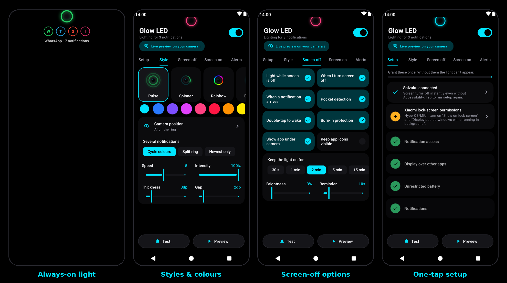
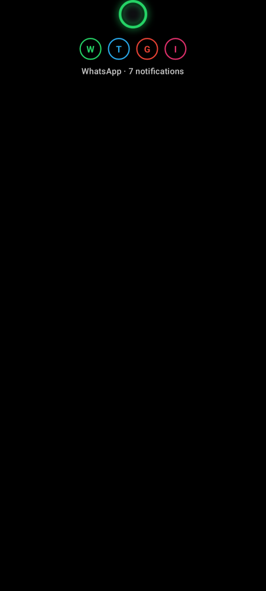
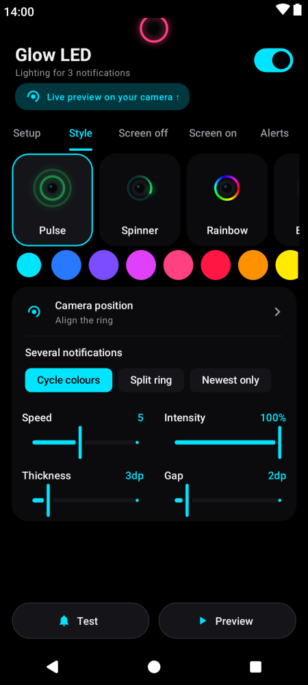
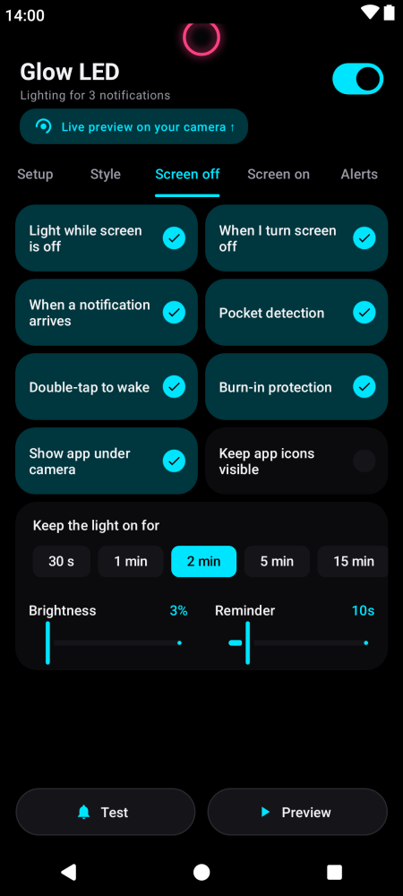
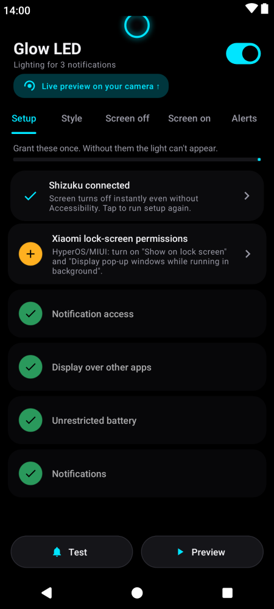

<p align="center">
  
</p>

<h1 align="center">Glow LED</h1>

<p align="center">
  A notification light for AMOLED phones. It glows around your camera hole, works on any brand, and uses very little battery.<br/>
  Android 10 and up.
</p>

<p align="center">
  <a href="releases/GlowLED-latest.apk?raw=1"><b>⬇ Download the latest APK</b></a>
  &nbsp;·&nbsp; ✅ signed build &nbsp;·&nbsp; <a href="releases/">all downloads &amp; install help</a>
</p>

<p align="center">
  
</p>

---

Most phones no longer have a notification LED. Glow LED draws one around the front camera
(punch-hole, pill, notch, or a plain dot on phones without a cutout). It shows while the screen is on,
on the lock screen, and while the phone is "off", using a black always-on screen. On AMOLED, black pixels
are switched off, so only the light itself uses power.

## Features

| | |
|---|---|
| **Cutout aware** | Detects the camera punch-hole, pill or notch automatically (exact shape on Android 12+). Fine-tune by dragging, with sliders, or in 1 px steps. Keeps its position when the screen resolution changes (Samsung FHD+/QHD+). |
| **9 animations** | Pulse, Breathe, Blink, Heartbeat, Spinner, Rainbow, Static ring, Edge lighting, Edge pulse. Adjustable speed, thickness, gap, intensity and glow. |
| **Colours** | Per-app colour you pick, or the app's own notification colour, or a colour taken from its icon. Several notifications can take turns, split the ring into colour segments, or show only the newest. |
| **Screen off (always-on)** | Black screen at minimum brightness and the lowest refresh rate, flicker-free. Timeout, optional reminder pulses, pocket detection, burn-in protection. Double-tap to wake, tap to show the app. |
| **App under the camera** | One UI-style strip of app icons (in each app's LED colour) with the app name and count, dropping in under the ring with a smooth motion. Double-tap to wake. |
| **Screen on** | A small light around the camera, also over the lock screen. |
| **Filters** | Turn individual apps on or off. Ignores silent, ongoing and progress notifications and group summaries. Respects Do Not Disturb. Can clear after you unlock. |
| **Battery** | Event-driven, so nothing runs in the background checking for notifications. 30 fps cap (configurable). Static and blink styles only redraw when they change. No foreground service. Low-battery cut-off, quiet hours, pause during calls. |
| **Any brand** | Shortcuts to the autostart/background settings on Xiaomi, Redmi, POCO, Samsung, OnePlus, OPPO, realme, vivo, iQOO, Huawei, Honor, ASUS, Tecno and Infinix. Reconnects itself if the system drops it. |
| **One screen** | Every setting is on the home screen in swipeable tabs (Setup, Style, Screen off, Screen on, Alerts, Battery, More) - no menus, almost no scrolling, controls in thumb reach. |
| **Easy updates** | Signed builds that install over each other, settings backup/restore to a file, a signature check and a "Check for updates" link in the More tab. |
| **Shizuku / root** | Optional one-tap setup that grants every permission at once (no "restricted settings" step), plus instant screen-off without Accessibility. |
| **Diagnostics** | Built-in event log (notification received, screen off, light started/skipped and why), copyable for bug reports. |
| **Extras** | Quick Settings tile, preview, test notification, themed (monochrome) icon. |

## Screenshots

| Always-on light | Styles & colours | Screen-off options | One-tap setup |
|:---:|:---:|:---:|:---:|
|  |  |  |  |
| Ring around the camera, app icons drop in below it. Everything else stays black, so AMOLED pixels stay off. | Tap an animation (live previews), pick a colour, tune speed, size and gap. | Every option on one screen: when to show, how long, pocket detection, double-tap to wake. | Shizuku/root grants everything in one tap, or follow the checklist. |

## How it works (for users)

1. A notification arrives and Glow LED picks its colour (your choice per app, the app's colour, or its icon colour).
2. **Screen on:** a small ring glows around the camera.
3. **Screen off:** the screen wakes to pure black at minimum brightness. The ring grows out of the camera and the app icons drop in below it.
4. **Double-tap** to wake to the lock screen, **tap** to show which app it is. After your chosen time (or when you clear the notification) the screen turns off again.

## Install

> ✅ **Signed build.** Every APK in [`releases/`](releases/) is signed with the official Glow LED key
> (SHA-256 `5D:04:DE:1A…0C:50:23`), so each new version installs **over** the previous one and keeps
> your settings.
>
> **"App not installed" / "Invalid package" when updating?** Your phone has an older build signed
> with a different key (the early v1.0.0–v1.2.0 GitHub releases). This is a one-time fix:
> 1. *(Optional)* Glow LED → **More** → **Back up settings**.
> 2. Uninstall the old app: long-press **Glow LED** → **App info** → **Uninstall**.
> 3. Install [`GlowLED-latest.apk`](releases/GlowLED-latest.apk?raw=1) again.
> 4. *(Optional)* Glow LED → **More** → **Restore settings**.
>
> After that, updates install normally. The **More** tab shows *Official signed build* when you have the right one.

1. Download [`GlowLED-latest.apk`](releases/GlowLED-latest.apk?raw=1) and open it (allow "install unknown apps" for your browser or file manager).
2. Open **Glow LED** and work through the **Setup** tab:
   - **Notification access** (required): lets the app know a notification arrived. Nothing leaves your phone.
   - **Have [Shizuku](https://shizuku.rikka.app/download/) or root?** Tap *One-tap setup* at the top of the Setup tab and everything below is granted for you.
   - **Display over other apps**: lets the light appear while the screen is off. This alone is enough.
   - **Accessibility** (optional): makes the light unblockable on strict ROMs (HyperOS, ColorOS...) and switches the screen off instantly when the light times out. It reads no screen content.
   - **Unrestricted battery** and, on Xiaomi/OPPO/vivo/Huawei and similar, **Autostart**.
3. In the **Style** tab tap **Camera position**, then **Auto-detect**, adjust if needed, and **Save**.
4. Tap **Test notification**, then turn the screen off.

> **Android 13+ "Restricted setting" dialog:** apps installed from an APK can't enable accessibility straight away.
> Open *Settings → Apps → Glow LED → ⋮ (top right) → Allow restricted settings*, then enable it again.

## How it works

```
NotificationListenerService ──► NotificationStore ──► LedController
   (system-bound, no polling)     (unseen notifications,     │
                                   one colour each)          ├── screen ON  → OverlayHost → LedView (small window around the camera)
                                                             └── screen OFF → AodActivity → LedView (black, min brightness, low Hz)
```

* **Turning the screen on and off:** with Accessibility enabled, the always-on screen is a full-screen
  accessibility overlay (`AodOverlay`) and the panel is woken with a short wake lock. That isn't an
  activity start, so ROMs that block background activities (HyperOS/MIUI, ColorOS, OriginOS) can't stop it.
  Without Accessibility, `AodActivity` (`showWhenLocked` + `turnScreenOn`) is launched through the overlay
  permission, with a full-screen-intent fallback. When the light times out, the accessibility service locks
  the screen (`GLOBAL_ACTION_LOCK_SCREEN`) so the panel switches off straight away.
* **Rendering:** `LedView` builds one `Path` for the cutout shape and animates with `PathMeasure` segments.
  It allocates nothing per frame and schedules frames only as often as needed: never for static styles,
  only on the on/off switch for blink, and at the fps cap for the rest.
* **Cutout detection:** `Display.getCutout()` (API 29), plus `DisplayCutout.getCutoutPath()` on API 31+ for
  the exact hole. Punch-hole bounding boxes that reach the top edge are corrected heuristically.
  The position is saved in pixels together with the screen width at the time, so it scales when the resolution changes.

## Build

Requirements: JDK 17+, Android SDK 35.

```bash
./gradlew assembleDebug          # debug APK
./gradlew testDebugUnitTest      # unit tests
./gradlew lintDebug              # lint
./gradlew assembleRelease        # release APK (see signing below)
```

### Release signing

Locally, create `keystore.properties` in the project root (it is git-ignored):

```properties
storeFile=/absolute/path/to/glowled-release.jks
storePassword=...
keyAlias=glowled
keyPassword=...
```

On GitHub Actions, add these repository secrets (*Settings → Secrets and variables → Actions*):

| Secret | Value |
|---|---|
| `GLOWLED_KEYSTORE_BASE64` | `base64 -w0 glowled-release.jks` |
| `GLOWLED_KEYSTORE_PASSWORD` | keystore password |
| `GLOWLED_KEY_ALIAS` | `glowled` |
| `GLOWLED_KEY_PASSWORD` | key password |

Without these secrets, CI signs the APK with a throwaway debug key. Such APKs can't be installed over a properly signed release.

### Making a release

1. Bump `versionCode` / `versionName` in `app/build.gradle.kts` and update `CHANGELOG.md`.
2. Push to `main`. The **Build & Release** workflow tests, builds and signs the app, then creates the
   `v<versionName>` tag and GitHub Release with the APK and a SHA-256 checksum.
3. To rebuild an existing release (e.g. after adding the signing secrets), run the workflow from the
   *Actions* tab → *Build & Release* → *Run workflow*. The APK on the release is replaced.

## Troubleshooting

| Problem | Fix |
|---|---|
| Test does nothing when the screen turns off (Xiaomi/HyperOS) | Enable the **Accessibility overlay**, then the **Xiaomi lock-screen permissions** step. Check the *Log* tab: it says why the light was skipped. |
| Light stops after a while | Set battery to *Unrestricted* and allow *Autostart* (Setup list). On Xiaomi also lock the app in Recents. |
| Screen doesn't turn on when a notification arrives | Enable the accessibility overlay. On Xiaomi, also allow *Show on lock screen* and *Display pop-up windows while running in background* (the Autostart button opens that page). |
| Ring is slightly off-centre | *Camera position*, then nudge with the arrows. Some phones report a cutout box larger than the hole. |
| Screen stays on after the light times out | That happens without the accessibility service: the screen then turns off at your normal screen timeout. Enable accessibility for an instant switch-off. |
| Nothing for one app | *Apps & colours*: check the app is on. Silent notifications are ignored unless you turn that off in Settings. |

## Privacy

Glow LED has **no internet permission**. It reads only the app name and colour of each notification and
keeps them in memory. Notification text is never read or stored.

## License

[MIT](LICENSE)
