<p align="center">
  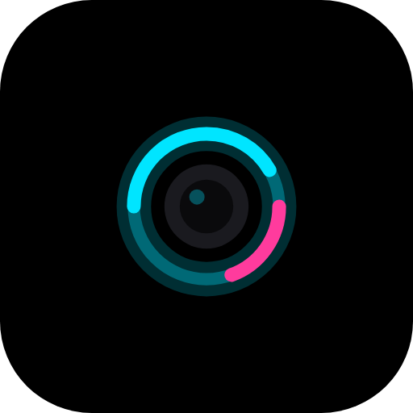
</p>

<h1 align="center">Glow LED</h1>

<p align="center">
  A notification light for AMOLED phones. It glows around your camera hole, works on any brand, and uses very little battery.<br/>
  Android 10 and up · English and Português (Brasil).
</p>

<p align="center">
  <a href="https://github.com/ankitchanki/LED/releases/latest/download/GlowLED-latest.apk"><b>⬇ Download the latest APK</b></a>
  &nbsp;·&nbsp; ✅ signed build &nbsp;·&nbsp; <a href="releases/">all downloads &amp; install help</a>
</p>

<p align="center">
  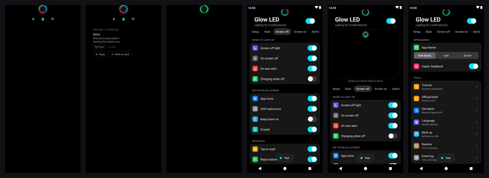
</p>

---

Most phones no longer have a notification LED. Glow LED draws one around the front camera
(punch-hole, pill, notch, or a plain dot on phones without a cutout). It shows while the screen is on,
on the lock screen, and while the phone is "off", using a black always-on screen. On AMOLED, black pixels
are switched off, so only the light itself uses power.

## Features

| | |
|---|---|
| **Cutout aware** | Detects the camera punch-hole, pill or notch automatically (exact shape on Android 12+). Fine-tune by dragging, with sliders, or in 1 px steps. Keeps its position when the screen resolution changes (Samsung FHD+/QHD+). |
| **11 animations** | Pulse, Breathe, Blink, Heartbeat, Spinner, Rainbow, Static ring, Edge lighting, Edge pulse, Twin orbit, Sparkle. Adjustable speed, thickness, gap, intensity and glow. |
| **Colours** | Per-app colour you pick, or the app's own notification colour, or a colour taken from its icon. With WhatsApp + Telegram + Instagram waiting, the ring splits into each app's colour (or cycles, or shows only the newest). |
| **Screen off (always-on)** | Black screen at minimum brightness and the lowest refresh rate, flicker-free (on Xiaomi/HyperOS the panel only wakes after the black frame is drawn, so there is no lock-screen flash). Timeout, optional reminder pulses, pocket detection, burn-in protection. Double-tap to wake, tap to show the app. |
| **App under the camera** | One UI AOD-style monochrome glyphs under the ring (grey; the newest in its notification colour), or full-colour app icons; tap one to read who sent what (text, or 📷 Photo / 🎥 Video / 🎤 Voice / 📄 Document) and tap the card to open the chat. A liquid droplet drips from the camera when a notification arrives. Double-tap to wake. |
| **Screen on** | A small light around the camera, also over the lock screen. |
| **Charging ring** | While charging, the ring fills with your battery level from the top, in your own colour per level (0–19 %, 20–79 %, 80–100 %), with a small **⚡ bolt in the gap at the bottom middle** of the ring. Every time the battery goes up 1 % (88 → 89 %) the bolt **flares brighter** for a moment. Plug in while the phone is locked or the screen is off and the ring shows for 5 seconds; turn on *Charging when off* to keep it on the black screen the whole time. Optional battery % under *Screen on → Charging & battery*. |
| **Download ring** | A download, upload or install with a progress notification shows a gauge or spinner around the camera, with just a small **↓ / ↑ arrow** sitting in the ring's bottom gap (no letters). App colours or your own upload/download colours. Appears on screen-on and active AOD views. |
| **Assign arrows** | *Screen on → Arrows*, laid out like iPhone settings. **Per-app arrows:** pick **Auto, ↓, ↑ or None** for any app, with a live ring preview; well-known apps already know their way (Play Store and browsers ↓, Google Photos backup ↑). **If unknown:** no icon (default), ↕, or treat as download/upload. Order: your choice → words in the notification → known app → *If unknown*. |
| **Reply & Mark as read** | Tap an app icon on the always-on screen, then **Reply** (type and send without opening the app; asks to unlock first) or **Mark as read**, using the app's own notification buttons. |
| **Filters** | Turn individual apps on or off. Ignores silent, ongoing and progress notifications and group summaries. Respects Do Not Disturb. Can clear after you unlock. |
| **Battery** | Event-driven, so nothing runs in the background checking for notifications. 30 fps cap (configurable). Static and blink styles only redraw when they change. No foreground service. **Still ring:** after 12 s on the always-on screen the animation holds still, so the screen isn't redrawn at all. **Dim older notifications:** fresh ones glow at full strength, then fade over an hour (you see new vs old at a glance, and fewer lit pixels). **Light up when the phone moves:** after the light times out it waits on the phone's motion chip instead of waking the screen on a timer. Low-battery cut-off, quiet hours, pause during calls. |
| **Any brand** | Shortcuts to the autostart/background settings on Xiaomi, Redmi, POCO, Samsung, OnePlus, OPPO, realme, vivo, iQOO, Huawei, Honor, ASUS, Tecno and Infinix. Reconnects itself if the system drops it. |
| **Organised settings** | Everything is on the home screen in swipeable tabs (Setup, Style, Screen off, Screen on, Alerts, Battery, Settings), each split into short named sections: *Style* → Animation · Colour · Shape & motion; *Screen off* → When to light up · On the black screen · Messages · Gestures & protection · Timing & brightness; *Screen on* → While you use the phone · Charging & battery · Downloads & uploads; *Alerts* → Apps · Filters; *Battery* → Power saving · Quiet hours; *Settings* → Appearance · Tools. No menus. |
| **iPhone-style settings** | Every tab is a grouped list like iPhone Settings: rounded groups, a small coloured icon on each row, sliding on/off switches, segmented controls for short choices and a value row for longer ones. Tabs are pills with a highlight that slides between them. Setup shows each permission as a row with a green tick or an orange **Allow**. |
| **One-handed mode** | Pull the settings down and the tabs and tiles slide into thumb reach (like One UI). The space above shows a **live preview** of the screen-off light (with the droplet falling into the app icon) that changes as you adjust settings. Swipe up or press back to return. |
| **Design** | Pure black by default with see-through glass cards and frosted, blurred dialogs (Android 12+); **light mode** in *Settings → App theme*. Runs at your display's full refresh rate (120 Hz). |
| **Haptics** | Sliders tick stronger as the value goes up and softer as it goes down; switches click firmly when turned on, lightly when off. Follows the phone's touch-feedback setting; can be turned off. |
| **Colour wheel** | Every colour picker has a ring of all colours you turn with your finger, plus saturation, brightness, presets and hex. |
| **Languages** | English and Português (Brasil). Follows the phone language, or pick one in *Settings → Language*. |
| **Easy updates** | Signed builds that install over each other. *Settings → Get latest* downloads the newest APK directly. Settings backup/restore to a file and a signature check. |
| **Shizuku / root** | Optional one-tap setup that grants every permission at once (no "restricted settings" step), plus instant screen-off without Accessibility. |
| **Diagnostics** | Built-in event log (notification received, screen off, light started/skipped and why), copyable for bug reports. |
| **Extras** | Floating see-through **Test** pill that never hides a setting, Quick Settings tile, swipe-down live preview, first-launch tutorial, themed (monochrome) icon. |

## Screenshots

| Always-on light | Tap an icon: Reply / Mark as read | Charging (screen off) |
|:---:|:---:|:---:|
|  | 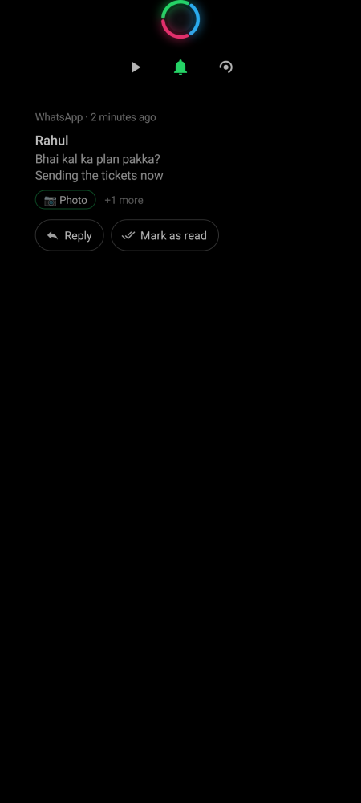 |  |
| Ring split into each app's colour; grey AOD-style glyphs below it, the newest in its notification colour. Everything else stays black. | Who sent what, left-aligned on pure black. **Reply** right there or **Mark as read**. | Plug in and the ring fills with the battery level, with a bolt at the bottom middle. |

| Setup | Style | Screen off |
|:---:|:---:|:---:|
| 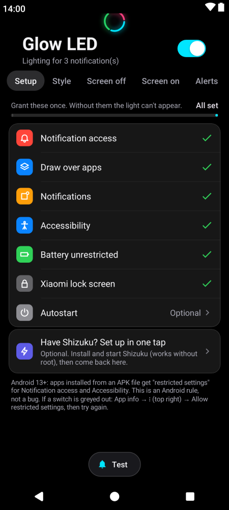 | 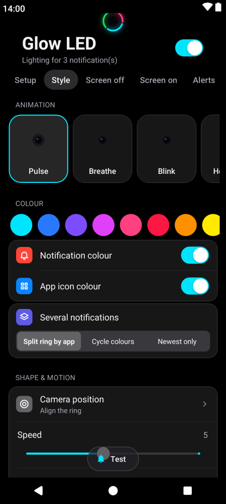 | 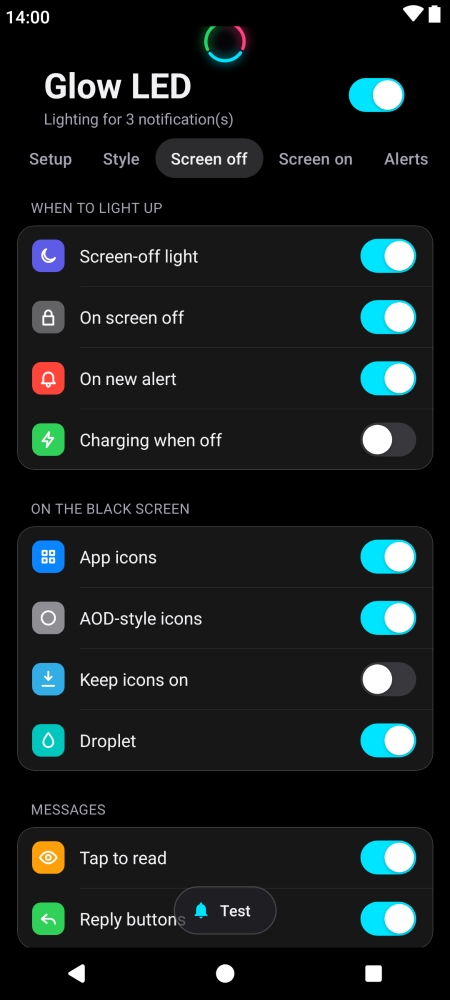 |
| Each permission is a row with a green tick; important ones first, Autostart and Shizuku last. | Animation, colour, shape & motion. | Settings grouped by what they do; the see-through **Test** pill floats above. |

| Screen on | One-handed mode | Settings |
|:---:|:---:|:---:|
| 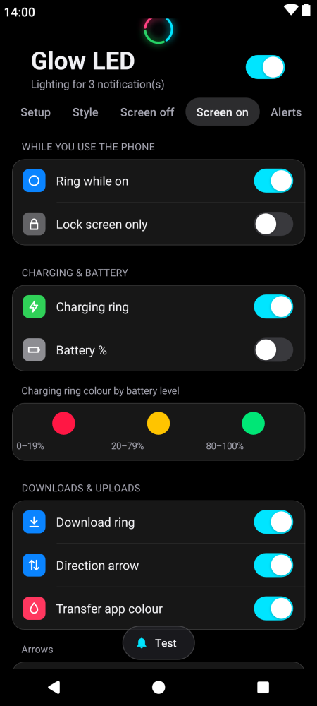 | 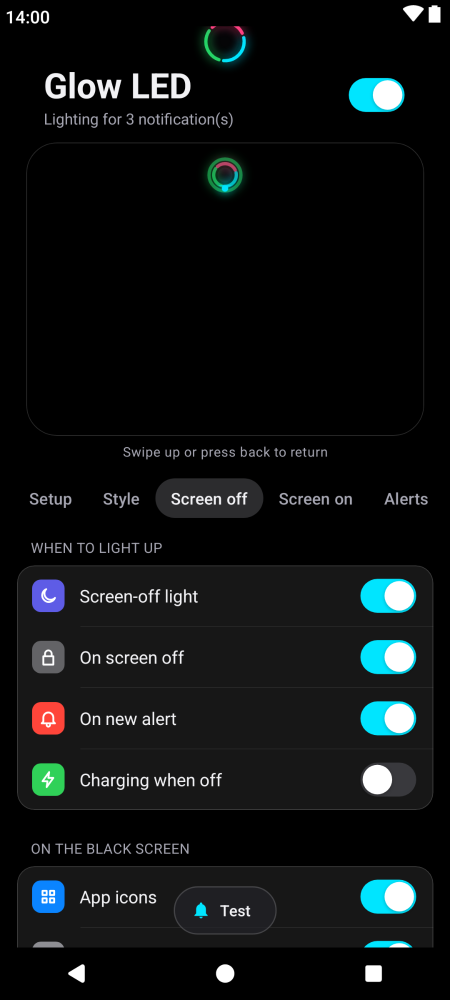 | 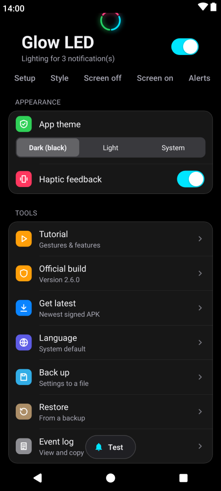 |
| Ring while on, charging ring colours, download ring with direction arrow and the Arrows settings. | Pull down: tabs and tiles come into thumb reach, with a live preview of the light above. | Appearance (theme, haptics) and Tools (tutorial, build check, latest APK, language, backup, restore, event log). |

| Per-app arrows | One app | If unknown |
|:---:|:---:|:---:|
| 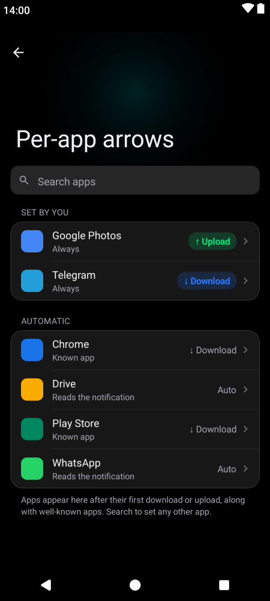 | 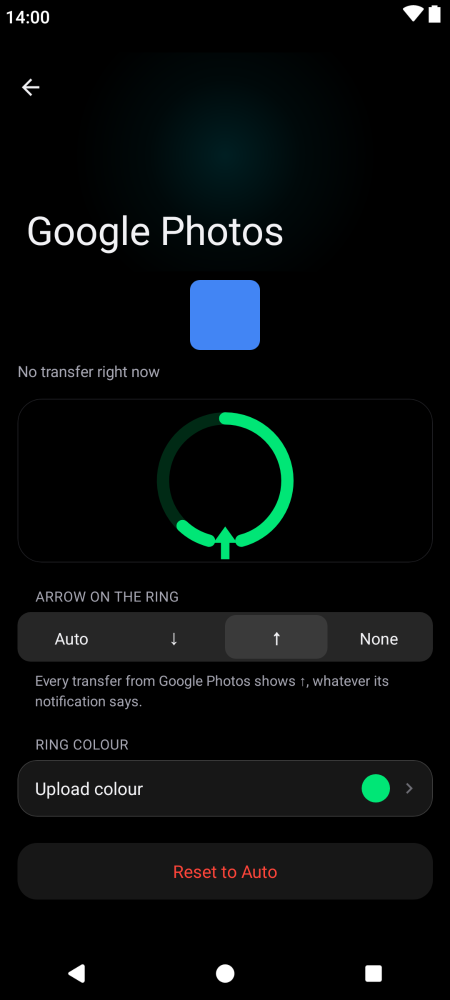 | 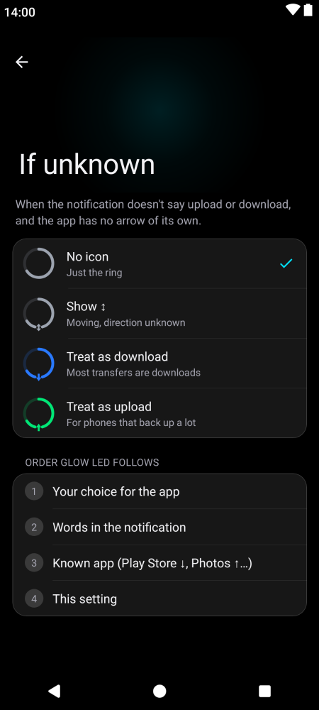 |
| Set an arrow for any app; well-known apps are automatic. | Auto, ↓, ↑ or None, with a live preview of the ring. | What shows when nothing tells the direction. |

| Light mode | Português (Brasil) |
|:---:|:---:|
| 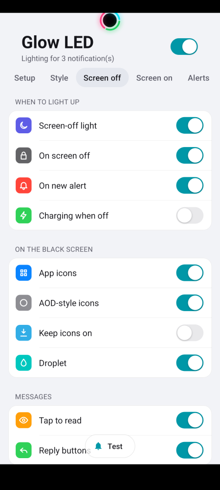 | 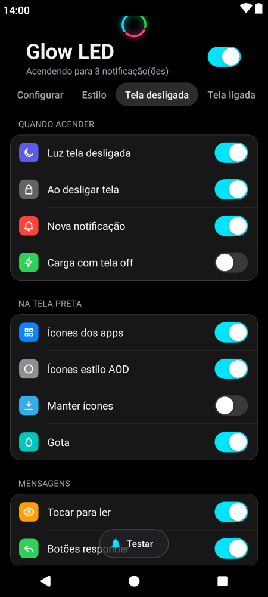 |

**Rings with icons:** charging at 42 % and 89 % (bolt), download (↓), upload (↑), and ↕ (optional, for an unknown direction). The icon sits in a small gap
at the bottom middle of the ring, in the ring's colour.


**Bolt flare:** each time the battery goes up by 1 %, the bolt grows and glows brighter for about a second (left: resting, right: flaring).

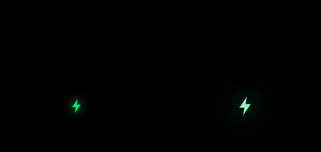

**Droplet:** when a notification arrives, a liquid drop in the app's colour stretches out of the camera,
breaks off, falls straight down into the middle of the icon row and turns into the app's icon.


## How it works (for users)

1. A notification arrives and Glow LED picks its colour (your choice per app, the app's colour, or its icon colour).
2. **Screen on:** a small ring glows around the camera.
3. **Screen off:** the screen wakes to pure black at minimum brightness. The ring grows out of the camera and the app icons drop in below it.
4. **Double-tap** to wake to the lock screen, **tap** to show which app it is. After your chosen time (or when you clear the notification) the screen turns off again.

## Install

> ✅ **Signed build.** Every APK in [`releases/`](releases/) is signed with the official Glow LED key
> (SHA-256 `5D:04:DE:1A…0C:50:23`), so each new version installs **over** the previous one and keeps
> your settings.
>
> **"App not installed" / "Invalid package" when updating?** Your phone has an older build signed
> with a different key (the early v1.0.0–v1.2.0 GitHub releases). This is a one-time fix:
> 1. *(Optional)* Glow LED → **Settings** → **Back up settings**.
> 2. Uninstall the old app: long-press **Glow LED** → **App info** → **Uninstall**.
> 3. Install [`GlowLED-latest.apk`](https://github.com/ankitchanki/LED/releases/latest/download/GlowLED-latest.apk) again.
> 4. *(Optional)* Glow LED → **Settings** → **Restore settings**.
>
> After that, updates install normally. The **Settings** tab shows *Official signed build* when you have the right one.

1. Download [`GlowLED-latest.apk`](https://github.com/ankitchanki/LED/releases/latest/download/GlowLED-latest.apk) and open it (allow "install unknown apps" for your browser or file manager).
2. Open **Glow LED** and work through the **Setup** tab:
   - **Notification access** (required): lets the app know a notification arrived. Nothing leaves your phone.
   - **Have [Shizuku](https://shizuku.rikka.app/download/) or root?** Tap *One-tap setup* at the top of the Setup tab and everything below is granted for you.
   - **Display over other apps**: lets the light appear while the screen is off. This alone is enough.
   - **Accessibility** (optional): makes the light unblockable on strict ROMs (HyperOS, ColorOS...) and switches the screen off instantly when the light times out. It reads no screen content.
   - **Unrestricted battery** and, on Xiaomi/OPPO/vivo/Huawei and similar, **Autostart**.
3. In the **Style** tab tap **Camera position**, then **Auto-detect**, adjust if needed, and **Save**.
4. Tap the floating **Test** pill, then turn the screen off.
5. For a live preview without locking, scroll any settings page to the top and **swipe down**; swipe up or press Back to close. Reopen **Settings → Tutorial** for all gestures and features.

The screen-off view wakes the panel and draws black; it is not native hardware AOD. OLED pixels can switch off at black, while LCD panels keep their backlight on and may look grey in a dark room. Transfer detection requires a progress notification; direction is shown as unknown when the notification does not identify upload or download.

> **Android 13+ "Restricted setting" dialog:** apps installed from an APK can't enable accessibility straight away.
> Open *Settings → Apps → Glow LED → ⋮ (top right) → Allow restricted settings*, then enable it again.

## How it works

```
NotificationListenerService ──► NotificationStore ──► LedController
   (system-bound, no polling)     (unseen notifications,     │
                                   one colour each)          ├── screen ON  → OverlayHost → LedView (small window around the camera)
                                                             └── screen OFF → AodActivity → LedView (black, min brightness, low Hz)
```

* **Turning the screen on and off:** with Accessibility enabled, the always-on screen is a full-screen
  accessibility overlay (`AodOverlay`) and the panel is woken with a short wake lock. That isn't an
  activity start, so ROMs that block background activities (HyperOS/MIUI, ColorOS, OriginOS) can't stop it.
  Without Accessibility, `AodActivity` (`showWhenLocked` + `turnScreenOn`) is launched through the overlay
  permission, with a full-screen-intent fallback. When the light times out, the accessibility service locks
  the screen (`GLOBAL_ACTION_LOCK_SCREEN`) so the panel switches off straight away.
* **Rendering:** `LedView` builds one `Path` for the cutout shape and animates with `PathMeasure` segments.
  It allocates nothing per frame and schedules frames only as often as needed: never for static styles,
  only on the on/off switch for blink, and at the fps cap for the rest.
* **Cutout detection:** `Display.getCutout()` (API 29), plus `DisplayCutout.getCutoutPath()` on API 31+ for
  the exact hole. Punch-hole bounding boxes that reach the top edge are corrected heuristically.
  The position is saved in pixels together with the screen width at the time, so it scales when the resolution changes.

## Build

Requirements: JDK 17+, Android SDK 35.

```bash
./gradlew assembleDebug          # debug APK
./gradlew testDebugUnitTest      # unit tests
./gradlew lintDebug              # lint
./gradlew assembleRelease        # release APK (see signing below)
```

### Release signing

Locally, create `keystore.properties` in the project root (it is git-ignored):

```properties
storeFile=/absolute/path/to/glowled-release.jks
storePassword=...
keyAlias=glowled
keyPassword=...
```

On GitHub Actions, add these repository secrets (*Settings → Secrets and variables → Actions*):

| Secret | Value |
|---|---|
| `GLOWLED_KEYSTORE_BASE64` | `base64 -w0 glowled-release.jks` |
| `GLOWLED_KEYSTORE_PASSWORD` | keystore password |
| `GLOWLED_KEY_ALIAS` | `glowled` |
| `GLOWLED_KEY_PASSWORD` | key password |

Without these secrets, CI signs the APK with a throwaway debug key. Such APKs can't be installed over a properly signed release.

### Making a release

1. Bump `versionCode` / `versionName` in `app/build.gradle.kts` and update `CHANGELOG.md`.
2. Push to `main`. The **Build & Release** workflow tests, builds and signs the app, then creates the
   `v<versionName>` tag and GitHub Release with the APK and a SHA-256 checksum.
3. To rebuild an existing release (e.g. after adding the signing secrets), run the workflow from the
   *Actions* tab → *Build & Release* → *Run workflow*. The APK on the release is replaced.

## Troubleshooting

| Problem | Fix |
|---|---|
| Test does nothing, or the lock screen flashes first (Xiaomi/HyperOS) | Set *Screen off → Screen-off method* to **Auto**, enable the **Accessibility overlay**, then the **Xiaomi lock-screen permissions** step. Check *Settings → Event log*: it says why the light was skipped. |
| Light stops after a while | Set battery to *Unrestricted* and allow *Autostart* (Setup list). On Xiaomi also lock the app in Recents. |
| Screen doesn't turn on when a notification arrives | Enable the accessibility overlay. On Xiaomi, also allow *Show on lock screen* and *Display pop-up windows while running in background* (the Autostart button opens that page). |
| Ring is slightly off-centre | *Camera position*, then nudge with the arrows. Some phones report a cutout box larger than the hole. |
| Screen stays on after the light times out | That happens without the accessibility service: the screen then turns off at your normal screen timeout. Enable accessibility for an instant switch-off. |
| Nothing for one app | *Alerts → Apps*: check the app is on. Silent notifications are ignored unless you turn off *Alerts → Ignore silent*. |
| No charging ring when I plug in with the screen off | Turn on *Screen on → Charging ring* and *Screen off → Screen-off light*. It shows for 5 s; turn on *Charging when off* to keep it. |

## Privacy

Glow LED has **no internet permission**, so nothing can leave your phone. To show the tap-to-read card
it reads the sender and the latest message text of each notification and keeps them **in memory only**:
they are never written to storage, logged or sent anywhere, and they disappear when the notification is
dismissed. Turn off *Screen off → Tap icon to read message* to stop reading message text entirely.
Notifications an app marks as secret never show their content.

## License

[MIT](LICENSE)
